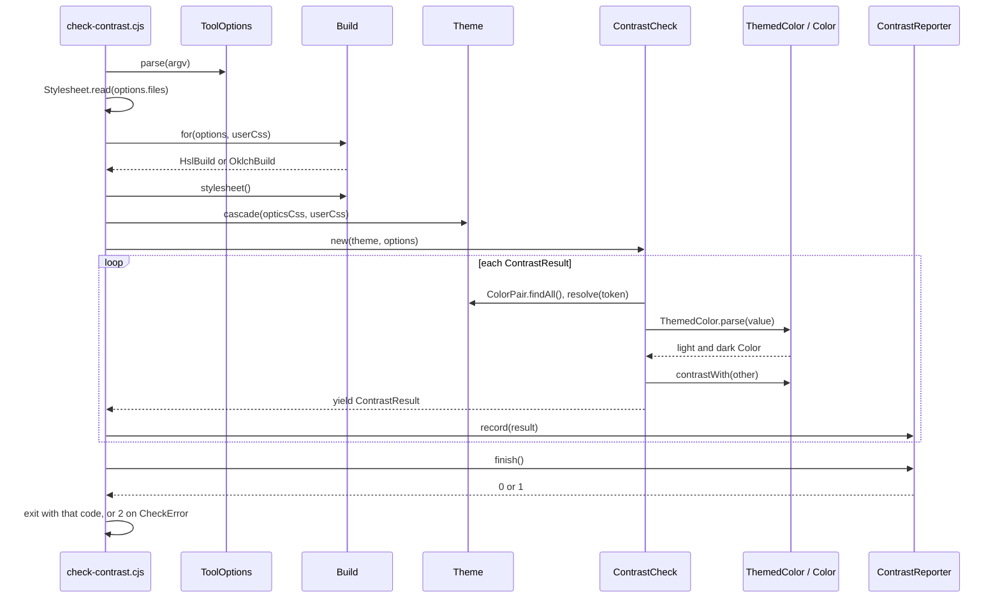
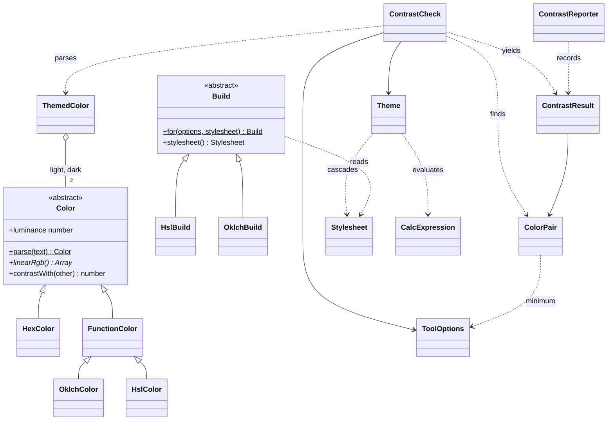

# Contrast checker: object design

Status: all phases done. Approved: `Color` with its subclasses, `ToolOptions`, `Stylesheet`, `Build` with its subclasses, `Theme`, `CalcExpression`, `ColorPair`, `ThemedColor`, `ContrastCheck`, `ContrastResult`, `ContrastReporter`, `CheckError`. Open: none.

The current refactor split `src/tools/check-contrast.cjs` into files, but most files are still loose functions. Only `TokenSheet`, `ContrastCheck` and `Reporter` are classes. This plan names the real objects in the tool, what each one knows and does, and how they talk to each other.

## How the tool runs

1. **Read the command.** Parse argv into files, a forced build (`--hsl` / `--oklch`), two minimum ratios, and the report flag.
2. **Read the user's CSS.** Read every file and strip comments.
3. **Pick the build.** Use the forced build, or detect HSL or OKLCH from the user's CSS.
4. **Read the Optics CSS.** Read that build's token files.
5. **Apply the cascade.** Collect every custom property, Optics first and the user's second. The last value wins, but a normal value cannot replace an `!important` one.
6. **Find the pairs.** Each `--op-color-<name>-on-<step>[-alt]` token, with its `--op-color-<name>-<step>` background.
7. **Measure each pair.** For each token: substitute `var()`, work out `calc()`, split `light-dark()` into a light and a dark color, parse each color, and get its luminance. Then get the ratio for each mode and compare it with the pair's minimum.
8. **Report.** Print a line per result (with `--report`), then a summary and the failures. Exit with 0 or 1.
9. **On any unreadable input,** stop and exit with 2.

## The objects

| Object                                            | Knows                                                    | Does                                                                                                        | Talks to                       |
| ------------------------------------------------- | -------------------------------------------------------- | ----------------------------------------------------------------------------------------------------------- | ------------------------------ |
| `check-contrast.cjs` (bin script, not a class)    | argv, stdout, stderr                                     | Runs steps 1–9 in order. Turns a `CheckError` into exit 2.                                                  | every object below             |
| `ToolOptions`                                     | files, forced build name, `min`, `altMin`, report flag   | `ToolOptions.parse(argv)` validates flags                                                                   | none                           |
| `Stylesheet`                                      | CSS text, without comments                               | `Stylesheet.read(paths)`, `declarations()` yields `{ name, value, important }`, `mentions(pattern)`         | file system                    |
| `Build` with `HslBuild`, `OklchBuild`             | name, token directory, channel variable, color function  | `Build.for(options, stylesheet)` picks the subclass, `stylesheet()` reads its Optics CSS                    | `Stylesheet`                   |
| `Theme`                                           | custom property values after the cascade                 | `Theme.cascade(...stylesheets)`, `has`, `names`, `resolve(name)` substitutes `var()` and works out `calc()` | `Stylesheet`, `CalcExpression` |
| `CalcExpression`                                  | the tokens of one `calc()`, a position                   | `evaluate()`: `+ - * /` with precedence                                                                     | none                           |
| `ColorPair`                                       | background token, text token, variant                    | `ColorPair.findAll(theme)`, `minimum(options)` returns `min` or `altMin`                                    | `Theme`, `ToolOptions`         |
| `ThemedColor`                                     | a light `Color` and a dark `Color`                       | `ThemedColor.parse(value)` splits `light-dark()`, `in(mode)`                                                | `Color`                        |
| `Color` with `HexColor`, `OklchColor`, `HslColor` | linear sRGB channels                                     | `Color.parse(text)` picks the subclass, `luminance`, `contrastWith(other)`                                  | none                           |
| `ContrastCheck`                                   | a `Theme`, `ToolOptions`                                 | `*results()` measures each pair in each mode                                                                | `ColorPair`, `ThemedColor`     |
| `ContrastResult`                                  | pair, mode, ratio, minimum                               | `passes`                                                                                                    | none                           |
| `ContrastReporter`                                | an output stream, the build, `ToolOptions`, the failures | `record(result)`, `finish()` prints the summary and returns 0 or 1                                          | `ContrastResult`               |
| `CheckError`                                      | a message                                                | marks input the tool cannot read or measure                                                                 | none                           |

### `Build` factory

`Build` is the base class. `HslBuild` and `OklchBuild` each set four things: `name`, `tokenDirectory`, `channelVariable` (`-s` or `-c`) and `colorFunction` (`hsl()` or `oklch()`). The base class reads the three token files from `tokenDirectory`.

The factory method `Build.for(options, stylesheet)` picks the subclass:

1. If `--hsl` or `--oklch` was passed, use that build.
2. If only one build's channel variable is in the stylesheet, use that build. If both are, throw "Could not tell".
3. If only one build's color function is in the stylesheet, use it. OKLCH is checked first, as today.
4. If the stylesheet is empty, use `OklchBuild`.
5. Else, throw "Could not tell".

To add a build, add a subclass and list it in the factory.

### What changes from the current refactor

- **The color math moves into the color objects.** `oklchToLinearSrgb` becomes part of `OklchColor`, and `hslToSrgb` becomes part of `HslColor`. `linearize`, `relativeLuminance` and `contrastRatio` become `Color` methods. `color.cjs` and `color-math.cjs` go away.
- **`Build` subclasses replace the `colorSet` string.** Today the string is checked in four places (`colorSet === 'oklch' ? 'oklch' : ''` and others).
- **`Stylesheet` and `Theme` split into two jobs.** `Stylesheet` reads CSS syntax. `Theme` applies the cascade. Today `TokenSheet.parse` does both.
- **`ColorPair` picks its own minimum.** `pair.minimum(options)` replaces `alt ? this.#altMin : this.#min`. `ToolOptions` only holds the arguments.
- **`ContrastResult` becomes a real type.** It replaces the anonymous `{ text, mode, ratio, min, passes }` object.
- **`CalcExpression` replaces the closures** in `calc.cjs`. The parser position becomes object state.
- **`Reporter` becomes `ContrastReporter`,** and it gets an output stream.

### What stays as functions

- `stripComments`, `findClosingParen` and `splitAtFirstComma` in `css-syntax.cjs`. They hold no state, and three objects use them. A class here would only wrap them.

## How the objects talk

## Decisions

1. **Where the output text lives.** Decided: `ContrastReporter` formats every line, so all of stdout is in one place.
2. **File layout.** Decided: one file per class, with `colors/` for the color classes and `builds/` for the build classes. This is about 18 files.
3. **Tests.** Decided: move the 35 comparison cases into the repo as `node:test` fixtures, and make `yarn test` run them.
4. **`TokenSheet` and `Stylesheet`.** Decided: keep both, and rename `TokenSheet` to `Theme`. A `Stylesheet` is one source of CSS, with every declaration in source order. A `Theme` is the cascade of the Optics and user stylesheets, with one final value per property, like `getComputedStyle(:root)`.
5. **`CheckError`.** Decided: keep it. Bad input prints one line and exits with 2. A bug in the checker keeps its stack trace.
6. **`ContrastCommand`.** Decided: no class. The bin file `check-contrast.cjs` does the wiring as a short script: it parses the options, reads the files, picks the build, makes the `Theme`, runs the check, sends results to the reporter, and turns errors into exit codes. `ContrastCheck` stays the domain job and knows nothing about argv, files, stdout or exit codes. Tests run the bin as a process.

## Phases

Each phase ends with `yarn test` and `yarn sanity-check`.

1. **Tests:** done. `test/contrast/check-contrast.test.cjs` holds every case inline: its CSS, its arguments, and the exit code and lines it must print. The test writes the CSS to a temp folder and runs the bin there. There are 37 cases, including the two empty-value forms from the PR #368 fix. `yarn test`, `yarn sanity-check` and the Linting CI workflow run them.
2. **Colors:** done. The classes are in `src/tools/contrast/colors/`. `FunctionColor` sits between `Color` and `OklchColor` / `HslColor`: it splits the channels of a CSS color function, rejects translucent colors, and reads each channel as a number, a fraction or a hue. `Color.parse` requires the subclasses on first use, because each subclass requires `color.cjs` to extend it. `color.cjs` and `color-math.cjs` are removed.
3. **CSS reading:** done. `Stylesheet` (`stylesheet.cjs`) reads files, strips comments and yields declarations. `Build` with `HslBuild` and `OklchBuild` is in `builds/`, and `Build.for` is the factory. `CalcExpression` (`calc-expression.cjs`) holds its tokens and position as fields. `Theme` (`theme.cjs`) applies the cascade and replaces `TokenSheet`. `token-sheet.cjs`, `calc.cjs` and the old loader are removed, and `stripComments` moved into `Stylesheet`. One change: if the Optics token files are missing, the checker now exits with 2 and `File not found`, not a stack trace with exit 1.
4. **Pairs:** done. `ColorPair` (`color-pair.cjs`) finds the pairs with `ColorPair.findAll(theme)` and picks its minimum with `minimum(options)`. `ContrastResult` (`contrast-result.cjs`) holds the pair, mode, ratio and minimum, and works out `passes`. `ContrastCheck` yields a `ContrastResult` per pair and mode. The modes are `ThemedColor.MODES`. The reporter now reads `result.pair.text` and `result.minimum`.
5. **Bin:** done. `ToolOptions` (`tool-options.cjs`) replaces `readOptions`, and holds the forced build as `buildName`. `ContrastReporter` (`contrast-reporter.cjs`) writes to the output stream it is given. The bin parses the options, reads the user's `Stylesheet`, asks `Build.for` for the build, cascades the `Theme`, runs `ContrastCheck`, and sends each result to `ContrastReporter`. `options.cjs` and `reporter.cjs` are removed.

## Out of scope

- The open Copilot comment on PR #368 about `@import`. Imported theme files are not read today. If it is fixed later, `Stylesheet.read` is where import expansion or rejection goes.
