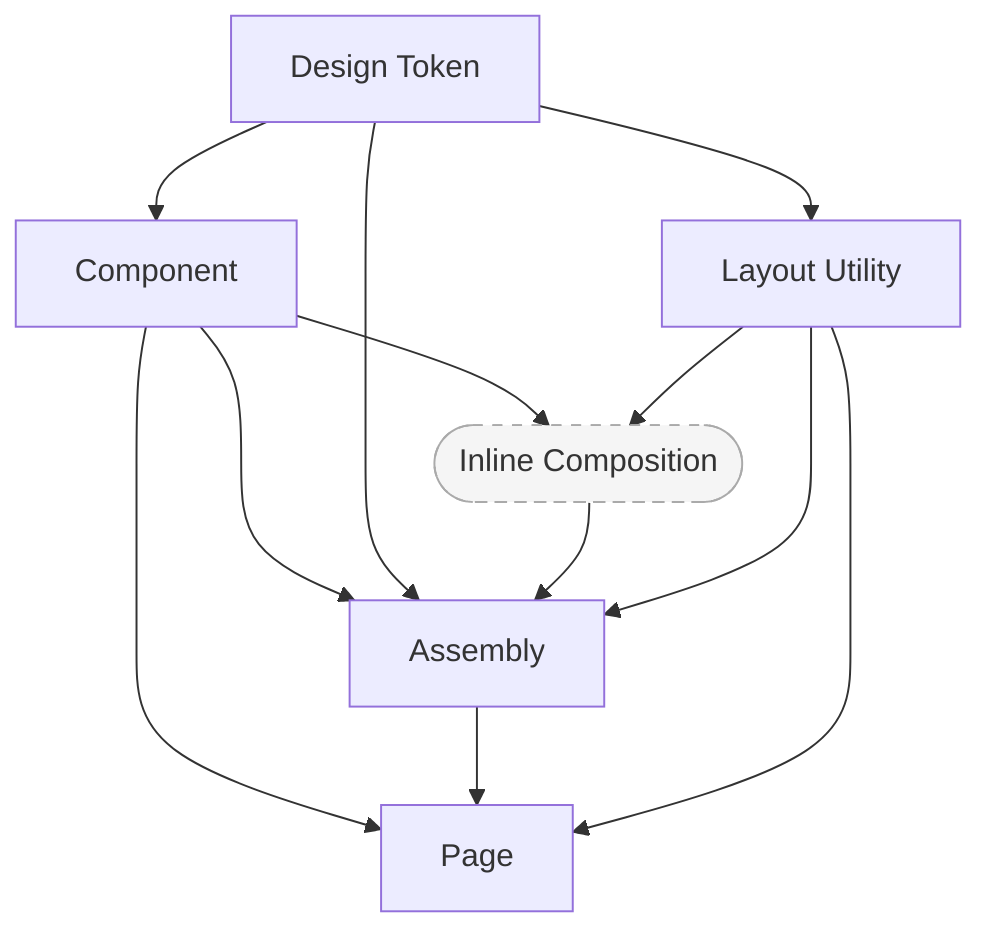
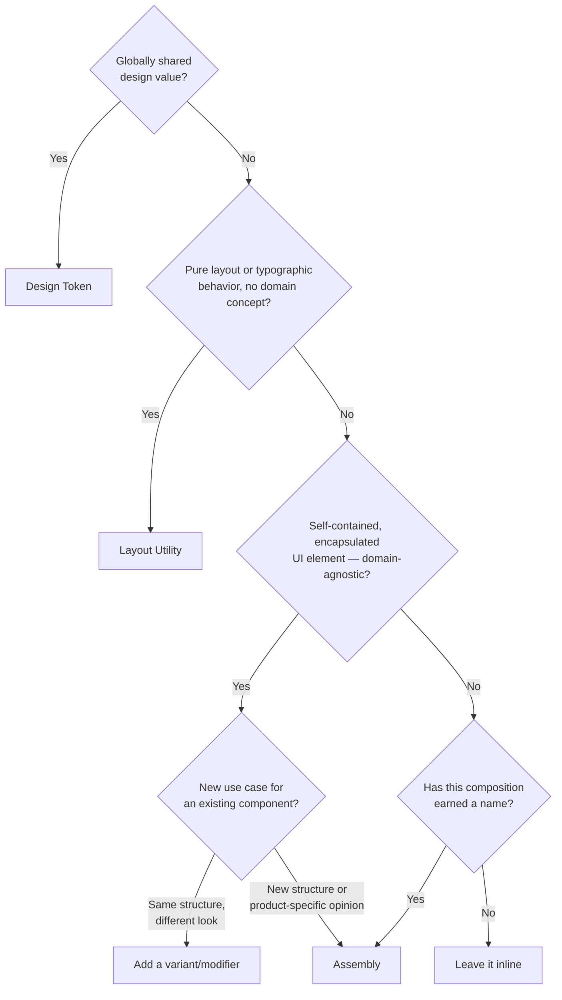

# UI Building Guide

A practical guide for developers and designers building product UIs with the Optics design system. Framework-agnostic — the concepts apply whether you're writing BEM + Stimulus, React, web components, or a mix.

This guide covers *what each level of the hierarchy is*, *when to build at that level*, and *how to name things*.

---

## The Hierarchy



Design tokens feed everything — utilities, components, and assemblies all consume token values directly. Layout utilities and components can be used in inline compositions, assemblies, and pages. Inline composition is not a deliverable — it's a threshold; when a composition earns a name, it becomes an assembly. Every artifact fits exactly one level — if you're unsure which, the decision flowchart at the bottom of this guide will help.

---

## Design Token

A named variable that encodes a single design decision — color, spacing, radius, shadow, or typography. Tokens are the source of truth for visual values. When a design value changes, you update the token and every consumer inherits it automatically.

```css
--op-color-primary-base: hsl(216, 58%, 48%);
--op-space-md: 1.6rem;
--op-radius-pill: 9999px;
```

**Build a token when:**

- A value is used in more than one place
- The value carries design intent a name should communicate (`--op-color-alerts-danger-base` means something; `#c0392b` does not)
- The value needs to participate in theming (light/dark, brand switching)

**Don't build a token for:**

- A one-off value internal to a single component — keep those as local variables inside the component

**Naming tokens:** See the [Optics token reference](https://docs.optics.rolemodel.design/?path=/docs/overview-tokens--docs) for the full naming conventions and available token catalog.

---

## Layout Utility

A single-purpose CSS class that applies one layout behavior. Layout utilities compose — the consumer stacks them to describe the layout they need. They carry no domain meaning and hold no internal structure.

```html
<div class="op-cluster gap-md items-start">
  ...
</div>
```

**Build a layout utility when:**

- The same layout pattern recurs across unrelated contexts
- An assembly would add no value beyond the layout itself — if you'd only be wrapping children in a flex row, a utility is the right tool

**Don't build a layout utility for:**

- Anything that needs JS behavior, internal structure, or event handling — that's a component
- One-off layout needs — write the styles inline or in a scoped class

**Naming utilities:**

Prefer short, spatial names. Optics uses `op-` for named layout patterns (`op-stack`, `op-cluster`, `op-grid`) and atomic helpers without a prefix (`gap-md`, `items-center`, `flex-wrap`).

---

## Component

A self-contained, styled UI element with scoped styles and optional behavior. Components expose a props or attribute API and are domain-agnostic — they model UI concepts, not business ones.

In a web component or framework context:

```html
<op-button variant="primary" size="medium">Save</op-button>
<op-badge variant="warning">Pending</op-badge>
```

In a BEM context, the component is a CSS block with its own markup:

```html
<button class="btn btn--primary btn--medium">Save</button>
<span class="badge badge--warning">Pending</span>
```

**Build a component when:**

- The element needs encapsulated styles that shouldn't bleed into or be overridden by the surrounding page
- It wraps a native interactive element (`<button>`, `<input>`, `<details>`) to add design-system styling while preserving semantics and accessibility
- It will be reused across many unrelated pages and contexts
- It is driven by UI concerns, not business logic

**Don't build a component for:**

- A one-time layout need — use a utility class
- An opinionated composition tied to a specific product domain — that's an assembly

### Variants and modifiers

A variant (or modifier) is the right tool when you need a **visual or behavioral variation of the same UI concept**. The component's structure stays the same; only its appearance or interaction changes.

```html
<!-- Same concept, different visual weight -->
<op-button variant="primary">Save</op-button>
<op-button variant="ghost">Cancel</op-button>

<!-- Same concept, different size -->
<op-badge size="small">New</op-badge>
<op-badge size="large">New</op-badge>
```

**Add a variant / modifier when:**

- The new use case is still recognizably the same UI element
- The structure (slots, sub-elements, markup shape) doesn't change
- The difference is visual: color, size, weight, shape

**Don't add a variant — build an assembly instead — when:**

- The new use case adds new structure (extra slots, sub-elements, wrapper markup)
- It bundles opinionated content or layout decisions the base component shouldn't own.
- Adding a variant / modifier makes it harder to use or reuse the underlying components.
- It makes sense only in one product context

### Modifier vs. assembly: the deciding question

> *Is this a different look for the same thing, or a different thing that happens to use this component?*

A danger alert that's red instead of blue is a variant. A notification card that uses a badge, an icon, a message, and an action button assembled in a specific way is an assembly.

### Naming components

Name for purpose, not appearance. The goal is to reveal the component's role in the user's workflow, not the CSS it applies.

```html
<!-- Describes styling — avoid -->
<button class="btn btn--blue">Save</button>

<!-- Describes a specific workflow — too narrow for a reusable component -->
<button class="btn btn--create-new-user">Save</button>

<!-- Generalizes the shared pattern — better -->
<button class="btn btn--submit">Save</button>

<!-- Names the broader UI abstraction — preferred when one exists -->
<button class="btn btn--primary">Save</button>

<!-- In a component library -->
<op-button variant="primary">Save</op-button>
```

A component can represent a generic UI concept (`btn`, `badge`, `card`) or a business domain concept (`playing-card`, `slide-preview`). Either is valid — what matters is that the name communicates intent, not implementation.

### Controlled and uncontrolled components

Some components manage their own internal state — these are uncontrolled. A controlled variant accepts that state as a prop and delegates the change decision to the caller.

```html
<!-- Uncontrolled: the component manages its own checked state -->
<op-switch label="Email notifications"></op-switch>

<!-- Controlled: the caller owns the state -->
<op-switch
  label="Email notifications"
  .checked=${emailEnabled}
  @change=${e => emailEnabled = e.detail.checked}
></op-switch>
```

Prefer uncontrolled by default. Expose a controlled API when callers need to coordinate the component's state with external state.

### Multi-element component families

Some components are too complex for a single element and split into a parent with named sub-elements. These coordinate internally while staying domain-agnostic at the component level — the parent manages state and behavior; the sub-elements expose the structure.

```html
<op-accordion>
  <op-accordion-item value="section-1">
    <op-accordion-trigger>Section one</op-accordion-trigger>
    <op-accordion-content>Content for section one.</op-accordion-content>
  </op-accordion-item>
</op-accordion>
```

Standard suffixes for sub-elements:

| Suffix | Use |
|---|---|
| `-trigger` | Initiates an action (open, close, toggle) |
| `-content` | Conditionally shown content area |
| `-header`, `-body`, `-footer` | Structural sections |
| `-title`, `-description` | Informational sub-elements |
| `-item` | Individual item within a repeating set |

An assembly can encapsulate a specific opinionated usage of the family; the component stays generic.

---

## Inline Composition

Any combination of components, assemblies, and utility classes assembled directly in a template — no extraction, no name, no file. Inline composition is the default. Most compositions should stay here.

```html
<!-- An inline composition: stays in the template -->
<div class="op-cluster gap-md">
  <op-stat label="Total" value="142"></op-stat>
  <op-stat label="Active" value="98"></op-stat>
  <op-stat label="Pending" value="12"></op-stat>
</div>
```

The question is not *what kind of thing is this* — it's *has this composition earned a name?*

**Leave it inline when:**

- It only appears in one place
- Its purpose is clear from the parts — reading the template tells you what it does
- It needs no behavior of its own

**Extract it into an assembly when:**

- It recurs in multiple places
- It needs its own behavior (event handling, state, data fetching)
- Naming it communicates intent the individual parts don't

When in doubt, leave it inline. Extracting too early creates rigid components that are difficult to work with.

---

## Assembly

> Other frameworks and methodologies often call this level a *block* (Atomic Design, components.build). We use *assembly* here to avoid confusion with BEM blocks, which refer to individual CSS components.

An opinionated, reusable composition that solves a concrete product use case. An assembly is a named inline composition — the same building blocks formalized with an interface.

```html
<member-profile
  src="/avatars/jeremy.jpg"
  name="Jeremy Walton"
  role="Lead Developer"
></member-profile>
```

Assemblies carry product decisions that components deliberately avoid: content structure, application vocabulary, opinionated defaults. This specificity is what makes them fast to use — consumers don't re-assemble the same composition from scratch every time.

**Extract an inline composition into an assembly when:**

- The same composition recurs across multiple pages or features
- The composition is complex enough that duplication would lead to divergence
- It needs behavior — event handling, state, or coordination — that would be awkward to repeat inline
- Naming it communicates intent the individual parts don't

**Don't build an assembly when:**

- A layout utility handles the entire need
- The composition is one-off and its purpose is clear from its parts
- The assembly would only proxy a component's own props without adding structure

### Naming assemblies

Assembly names should reflect their **product role**, not their visual appearance. Name for what it *represents*, not what it *looks like*.

```txt
// Good — names a concept
member-profile
activity-feed
invoice-summary

// Weak — names an appearance or structure
card-with-avatar
two-column-layout
bordered-list
```

If you can't name it without describing its visual structure, it may not have earned extraction yet.

---

## Page

A complete, single-route view composed of assemblies, inline compositions, and components. Pages coordinate data, routing, and layout for a specific user-facing purpose. They always live in the consuming application, not the design system.

```html
<page-header title="All Members">
  <op-button variant="primary">Invite member</op-button>
</page-header>

<div class="op-grid gap-lg">
  <op-stat label="Total" value="142"></op-stat>
  <op-stat label="Active" value="98"></op-stat>
</div>

<member-table members="members"></member-table>
```

---

## Decision Flowchart



---

## Common Missteps

**Modifier when you need an assembly.** If the new use case adds new slots, wraps the component in extra markup, or only makes sense in one product context — stop adding variants. Build an assembly that uses the component inside it.

**Assembly when you need a modifier.** If the assembly's only job is to change the color or size of an inner component and nothing else — delete the assembly, add a variant to the component.

**Assembly that proxies a component's props.** If an assembly has `variant`, `size`, and `disabled` props that pass straight through to an inner component, the assembly adds no abstraction — it duplicates the component's API. Expose the component directly, or pass it via a slot.

**Premature assembly extraction.** Extracting an inline composition before it has recurred, gained behavior, or earned a meaningful name creates an API contract you'll immediately regret. Leave compositions inline until one of those conditions is met.

**Layout utility disguised as an assembly.** If an assembly's only job is to arrange children in a flex row or grid, delete it. Use a layout utility.

**Naming an assembly for its appearance.** If your assembly is called `rounded-card-with-icon`, you're describing markup, not a product concept. Rename it or leave it inline.
